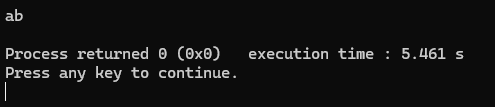
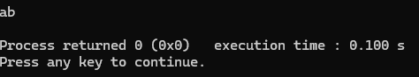
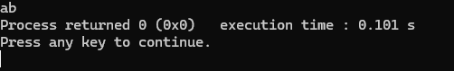
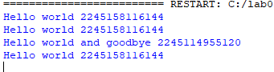
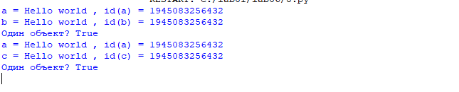

# Языки программирования
## Лабораторная работа 6

### Задание 1 **(3)**
*Рассмотрим следующую программу на С++.*
```
#include <iostream>
#include <cmath>
int main() {
   double x = 0;
   const auto Pi = std::acos(0) * 2;
   std::cout << Pi << std::endl;
   return 0;
}
```
*Проверьте четыре способа объявления* **Pi**.
* ```const auto Pi = acos(0) * 2;```
* ```constexpr auto Pi = std::acos(0) * 2;```
* ```const auto Pi = acos(x) * 2;```
* ```constexpr auto Pi = std::acos(x) * 2;```

*Что можно сказать об этих вариантах? Проверьте, в каких вариантах объявляется константа этапа трасляции.*

*Тексты программ разместите в папке с номером задания*


### Задание 2 **(2)**
*Проверьте работу следующей программы на С++*
```
#include <iostream>
int main() {
   {
      int x, y;
      std::cin >> x >> y;
      std::cout << x+y << std::endl;
   }
   {
      double x, y;
      std::cin >> x >> y;
      std::cout << x+y << std::endl;
   }
   return 0;
}
```
*Нужны ли в этой программе вложенные фигурные скобки? Дайте подробный ответ с объяснением причин.*
Вложенные скобки нужны, потому что внутри каждых скобок объявлены переменные с одинаковыми именами x и y, но разных типов. Объявить две переменные с одинаковым именем в одной и той же области видимости нельзя. Отсутствие скобок вызовет ошибку 

### Задание 3 **(2)**
*Проверьте работу следующего фрагмента программы на С++.*
```
int s = 0;
for (int i = 0; i < 4; i++) {
   for (int i = 0; i < 3; i++) {
      s += i;
   } 
   s += i; 
}
std::cout << s;
```
*В результате каких вычислений был получен ответ? Дайте подробный ответ.*
Внутренний цикл for (int i = 0; i < 3; i++) на каждой итерации внешнего цикла выполняется ровно 3 раза (при i равном 0, 1 и 2). Сумма, добавляемая внутренним циклом за один полный проход, равна:
0 + 1 + 2 = 3.
Внешний цикл выполняется 4 раза (для i от 0 до 3). На каждой итерации внешнего цикла к переменной s сначала добавляется результат внутреннего цикла (всегда 3), а затем текущее значение переменной i внешнего цикла.
### Задание 4 **(2)**

*Проверьте работу следующего фрагмента программы на* **Python**.
```
s = 0
for i in range(4):
   for i in range(3):
      s += i
   s += i
print(s)
```
*В результате каких вычислений был получен ответ? Дайте подробный ответ.*

*На основе этих примеров поясните различия между* **С++** и **Python** *при работе с переменными*.
В Python циклы for не создают изолированных областей видимости. Внутренний и внешний циклы используют одну и ту же переменную i.
Внешний цикл выполняется 4 раза. На каждой итерации происходит следующее:
1. Внешний цикл присваивает переменной i очередное значение из range(4).
2. Внутренний цикл for i in range(3): запускается и последовательно перезаписывает i значениями 0, 1, 2. При этом к s прибавляется 0 + 1 + 2 = 3.
3. После завершения внутреннего цикла в переменной i всегда остается её последнее значение — 2.
4. Строка s += i прибавляет это оставшееся значение (2) к общей сумме.


### Задание 5 **(2)**

*Напишите свой пример программы на* **С++**, *создающий и использующий пространства имен. Программа
должна содержать не менее двух пространств имен.*
Одинаковые имена s и print не конфликтуют, потому что находятся в разных пространствах имён. Полное имя включает пространство имён и имя объекта.
Вывод:

### Задание 6 **(2)**

*Рассмотрим следующий фрагмент программы. Эта программа 1000000 раз обменивает значения двух длинных 
строк с использованием третьей строки. Проверьте, насколько быстро она работает.*

```
std::string a(100000, 'a');
std::string b(100000, 'b');
for (int i=0;i<1000000;i++) {
   std::string c(a);
   a = b;
   b = c;
}
std::cout << a[0] << b[0];
```
Данная программа на моем устройстве работала 5.4 секунды.

*Попробуйте использовать для обмена значений строк функцию* **swap**. 
*Проверьте, изменилось ли время работы. В чем ошибка исходной программы?
Исправьте исходную программу, чтобы ускорить ее работу. Изменения не должны 
затрагивать общий вид программы (присваивания, использование временной переменной).*
Используя функцию **swap** программа работает не болеет 0.2 секунд.

В старой программе за одну итерацию делается 3 копирования по 100000 символов, при копировании выделяется новая память, а старая освобождается. В данной программе можно не использовать копирование, достаточно будет присваивания с семантикой перемещения. Для этого поможет функция move. С данной функцией программа работает ещё быстрее, так как копии новых данных не создаются.

Источник: https://docs-python.ru/tutorial/vstroennye-funktsii-interpretatora-python/funktsija-id/

### Задание 7 **(2)**

*Рассмотрим программу на языке* **Python**.
```
a = 'Hello world'
print(a, id(a))
b = a
print(b, id(b))
a += ' and goodbye'
print(a, id(a))
print(b, id(b))
```
*Объясните ее работу. В какой момент создавались строки? 
Что означает значение, возвращенное функцией* **id**?
Функция id позволяет узнать местоположение объекта. Но использовать его можно только для сравнения. 
При первом присваивании создаётся строковый объект 'Hello world', а имя a ссылается на него. После b = a оба имени ссылаются на один объект, поэтому первые два вызова id показывают одинаковое значение.

Строки в Python неизменяемы. Выражение a += ' and goodbye' создаёт новую строку с объединённым содержимым и связывает имя a с новым объектом. Имя b по-прежнему указывает на старую строку 'Hello world'. Поэтому последние две строки вывода показывают разное содержимое и разные значения id.


### Задание 8 **(2)**

*Пусть* **a** - *строковая переменная в программе на* **Python**.
*Есть ли разница между работой присваивания*
```b = a```
и
```b = a[:]```
*Напишите программу для демонстрации различий.*
b = a и b = a[:] работают практически одинаково. Разница только в синтаксисе. CPython оптимизировал операцию a[:] для строк и вернул ту же самую строку, а не создал новую копию.
Cтроки неизменяемы, поэтому нет смысла тратить память на создание копии. Компилятор понимает, что копия и оригинал будут вести себя одинаково.

###  Задание 9 **(3)**
*Напишите программу на языке* **Python**, *которая создаст 2600 переменных с именами
от* **a0** *до* **a99**, *от* **b0** *до* **b99** *и так далее, от* **z0** *до* **z99**. 
*Присвойте всем переменным различные значения от 1 до 2600.*

## Дополнительные задания

### Задание 1 **(3)**

*Пусть* **a**, **b**  *два списка в* **Python**. *Мы хотим обменять значения переменных следующим
образом.*
```
a, b = b, a
```
*Будет ли это работать? В какой последовательности будут происходить присваивания?
Будет ли зависеть время работы от размера списков? Обоснуйте ответ.*

### Задание 2 **(3)**
*Проверьте результаты сравнения в* **Python**.
```
id(100)==id(100)
```
и
```
id(1000)==id(1000)
```
*Как можно объяснить полученные результаты?*

### Задание 3 **(4)**
*Напишите функцию* **sumint** на **Python**, *которая найдет сумму всех целочисленных переменных, определенных
в среде* **Idle**. *Например*
```
>>> a = 10
>>> b = 1.5
>>> c = 15
>>> d = 'hello'
>>> sumint()
25
```

### Задание 4 **(10)**

*В языке* **С++** *для получения информации о расположении переменной в памяти 
можно использовать оператор взятия адреса* **&**. *Адрес можно интерпретировать, как 
беззнаковое длинное число с использованием* **reinterpret_cast**.

```
reiterpret_cast<unsigned long long>(&t);
```
*Здесь* **t** *имя некоторой переменной. Напишите несколько примеров, чтобы проверить, 
как размещаются переменные в памяти. В частности, можно рассмотреть следующие вопросы.*
* *Если объявить несколько переменных различных типов в одном блоке, то на какую величину 
отличаются их адреса? Соотносится ли эта величина с размером переменной в байтах.
Проверьте, имеются ли различия на разных уровнях оптимизации.*
* *Если имеется несколько блоков, расположенных последовательно, то могут ли переменные
в разных блоках иметь одинаковые адреса? Проверьте разные уровни оптимизации.*
* *Объявите несколько переменных типа* **std::string** *и попробуйте заносить
в них строки различной длины. Изменяется ли размер переменной, вычисленный с использованием*
**sizeof**? *Изменяется ли расположение переменной? Попробуйте объяснить полученные результаты.*
