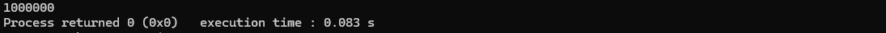
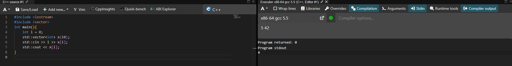
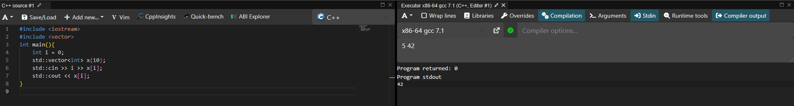

# Языки программирования
## Лабораторная работа 7

### Задание 1 **(2)**
*Оцените работу следующих фрагментов программ. Какие из них обладают неоднозначным поведением? Почему?*
```
int x=10, y=3;
std::cout << std::min(x=15, x+y);
```
Вызовы аргументов std::min не задают порядок вычисления слева направо. В C++17 какой аргумент вычислится первым, не определено. Поэтому возможны разные результаты:
1. Если первым выполнится x = 15, второй аргумент станет 15 + 3 = 18, результат — 15;
2. Если первым вычислится x + y, он даст 13, затем x станет 15, результат — 13.

```
int x=10, y=3;
x=15, y+=x, x+=y;
```
Здесь нет неоднозначности, ведь все вычесления выполняются слева направо из-за оператора запятая. В итоге получится x == 33, y == 18. 
```
int x=10, y=9;
if (x>y++ && y++>9)
  cout << "yes" << endl;
cout << y;
```
Здесь нет неоднозначности, потому что оператор && гарантирует вычисление слева. Правая часть будет вычислена если, если левая будет истина
*Тексты программ разместите в папке с номером задания*

### Задание 2 **(2)**
*Как записать следующие строки программы на С++ в виде одного
выражения? Приведите несколько способов, в том числе с использованием операторов инкремента.*
*Проверьте работу написанных программ*
```
x=x+1;
z=z+2*x+3*y;
y=y+1;
```
*Тексты программ разместите в папке с номером задания*

### Задание 3 **(2)**
*Рассмотрите следующий фрагмент программы. Он заполняет вектор из 10 элементов единицами.*
```
std::vector<int> x(10);
for (int i = 0; i < 10;)
   x[i++] = 1;
```
*Перепишите ее так, чтобы в третьей строке использовался префиксный инкремент, но результат ее работы не изменился.*
```
std::vector<int> x(10);
for (...)
   x[++i]=1;
```
Чтобы переписать цикл с использованием префиксного инкремента и сохранить логику, необходимо изменить начальное значение счетчика i на -1 и скорректировать условие останова.
```
std::vector<int> x(10);
for (int i = -1; i < 9; )
   x[++i] = 1;
```
### Задание 4 **(2)**

*Почему присваивание* ```(++x)=y``` *является синтаксически правильным, а*
```(x++)=y``` - *нет? Запишите текст сообщения об ошибке, переведите и объясните его.*
При компиляции будет такая ошибка: 
```lvalue required as left operand of assignment```
Перевод - «Требуется lvalue в качестве левого операнда присваивания»
Постфиксный инкремент увеличивает x, но возвращает старое, временное значение, которое было у x до увеличения (rvalue). У этого временного значения нет постоянного адреса в памяти, поэтому компилятор физически не может записать туда значение y.

### Задание 5 **(2)**

*Программисты на Python для обмена значений двух переменных часто пишут строку*
```
a,b = b,a
```
*Проверьте, будет ли аналогичная строка на С++ (с точкой с запятой в конце) являться синтаксически
правильной? Будет ли она обменивать значения переменных? Как в языке С++ вычисляется это выражение?*

Строка a,b = b,a; в C++ является синтаксически правильной, но она не будет обменивать значения переменных.
Значение переменных не изменится в резултате вычислений. Для обмена значениями в C++ используют функцию std::swap.
### Задание 6 **(2)**

*Проверьте работу следующего фрагмента программы*
```
  std::string s;
  for (int i=0; i<1000000; i++)
     s += 'a';
  std::cout << s.size();
```
*Измените третью строку на*
```
s=s+'a';
```
*Изменится ли что-нибудь в ее работе? Объясните результат.*
Вариант s += 'a'; изменяет строку сразу же. Добавление символа через += происходит очень быстро.
Скорость при s += 'a' - меньше секунды. 


Скорость при s = s + 'a' 14 секунд. 

### Задание 7 **(2)**

*Как работает следующая программа? Как зависит результат от исходного значения?*
```
int x;
std::cin >> x;
x-->0 && x-->0 && x-->0 && x-->0 && x-->0;
std::cout << x;
```
Запись x-->0 разбирается как (x--) > 0: сравнивается старое значение x с нулём, а затем x уменьшается на единицу. Оператор && вычисляет части слева направо и прекращает вычисления после первого ложного результата.

Если x <= 0 первая проверка ложна, но x-- всё равно выполняется, на экран выводится n - 1;
Если 1 <= x <= 4 выполняются n истинных проверок и одна ложная, на экран выводится -1;
Если x >= 5 выполняются все пять проверок, на экран выводится x - 5.

### Задание 8 **(3)**

*Какое число выводит следующий фрагмент программы? Посчитайте результат без использования
вычислительной техники. Отчет должен содержать процесс вычислений.*
```
int s = 0;
for (int i = 0, j = 5;i+j <= 16;(i<j ? i : j)++)
   (s += i) += j;
std::cout << s;
```

###  Задание 9 **(3)**
*Рассмотрите следующую программу. Предполагается, что на вход подается некоторый
индекс в массиве - число от нуля до девяти и значение, которое надо записать по этому индексу.*
```
int i = 0;
std::vector<int> x(10);
std::cin >> i >> x[i];
std::cout << x[i];
```
*Проверьте работу этой программы на различных компиляторах. Найдите два компилятора (можно 
проверить онлайн компиляторы), на которых эта программа будет давать различные ответы при одинаковом
вводе. Как это объяснить?*
Если использовать версию компилятора gcc 5.5, то программа будет выводить 0, т.к в этой версии компилятора не используется стандарт C++17.

При использовании gcc 7.1 (уже используется стандарт C++17) вывод будет 42 при входных данных 5 42.

Начиная с C++17, стандарт жестко зафиксировал порядок вычисления для операторов сдвига (<< и >>) — строго слева направо. Сначала вычисляется левая часть std::cin >> i (переменная i считывается и становится равной 5), и только затем вычисляется индекс x[i] (уже как x[5]). В стандартах до C++17 вычисляется сначала x[i], из-за этого запись числа уходит в x[0], а не в x[5]. Программа пытается вывести x[5], но она равна нулю, т.к в нее ничего не записано.
## Дополнительные задания

### Задание 1 **(2)**

*Найдите и объясните примеры "коварных" ошибок программистов на С++, связанных с вычислением выражений. 
Каждый пример оценивается в два балла. Примеры из лекции или из заданий не засчитываются.*
```
double n = 5 / 2
```
Несмотря на то что тип double, результат все равно будет равен 2, по причине того, что дробная часть отбрасывается.
```
double n = 5.0 / 2
```
Исправленный вариант выведет 2.5
```
if ( err == code1 && err == code2){
  ....
}
```
Результат выражения всегда будет ложным, потому что одна переменная не может одновременно хранить два разных значения.
### Задание 2 **(10)**
*Язык С++ позволяет записывать достаточно странные конструкции.
Следующая программа обладает неопределенным поведением. После компиляции с использованием 
Gnu C++ (g++) эта программа выводит числа 4 и 11. Рассмотрите ассемблерный код и объясните,
каким образом был получен ответ 11.*
```
int x, y;
y = (x=1) + (x=2) + (x=3) + (x=4);
std::cout << x << " " << y;
```

### Задание 3 **(10)**
*Прочитайте в стандарте языка С++ правила вычисления результата для тернарного оператора* **?:**. *Напишите примеры для каждого пункта правил.*
